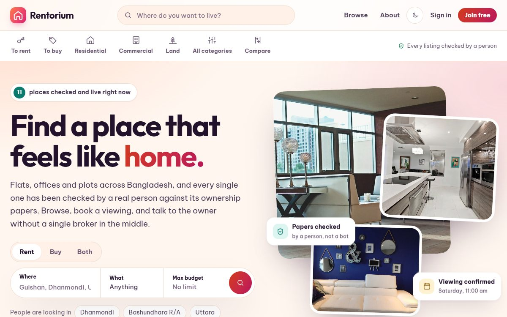
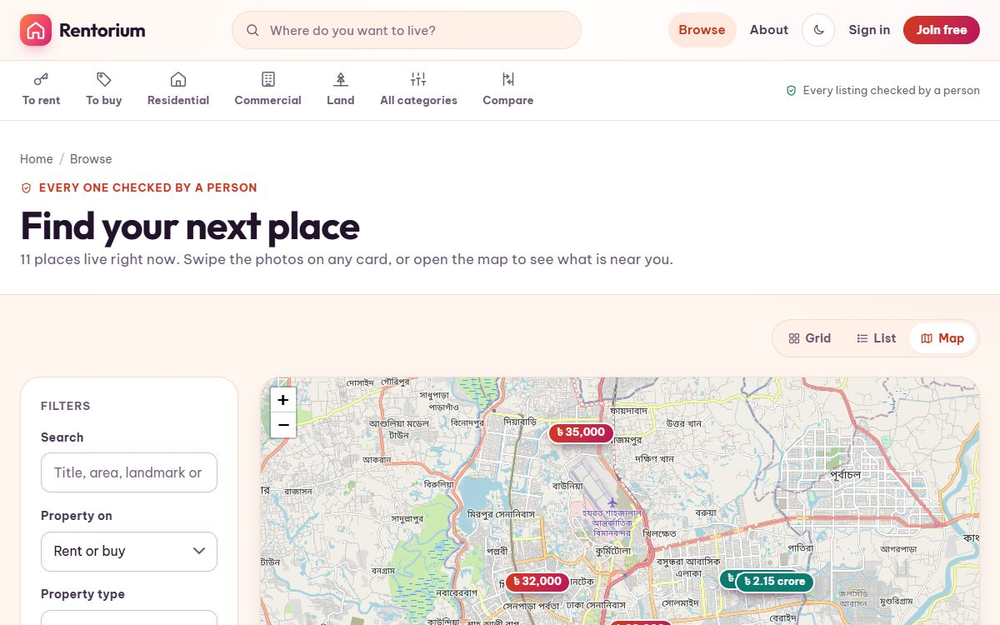

# Rentorium

[](https://github.com/FaiazPronoy/Rentorium/actions/workflows/tests.yml)

**A platform to rent or buy homes, offices and land in Bangladesh.**
Search listings, see them on a map, book a viewing and message the owner,
while an agent checks every listing before it goes live.

| | |
|---|---|
| **Course** | CSE471: System Analysis and Design, BRAC University |
| **Type** | Group project |
| **Made by** | Faiaz Abrar Zaman Pronoy, Sinthia Khandoker and Jahirul Islam Zishan |
| **Live demo** | https://faiazpronoy.pythonanywhere.com |
| **Versions** | [v1.0, the first version, and v2.0, the rebuild](../../releases) |

| | |
|---|---|
|  |  |

---

## Features

**For people looking for a place**
- Search by area, price, size, rooms, furnishing, amenities and more, with 7 sort orders
- See every result as a price pin on a map
- Swipe through a listing's photos right on its card
- See the full move-in cost for a rental, or a monthly instalment for a sale
- "What can I afford?" slider that turns your income into a comfortable rent
- Save searches and properties, and compare up to 4 side by side
- Book a viewing on a date and time you pick
- Message the owner, and review a place you have seen

**For owners**
- A guided form that only asks for what each type of property needs
- Up to 8 photos with a chosen cover photo
- Upload the ownership paper privately
- A dashboard with views, saves, enquiries and visit requests
- Hide a listing, or mark it rented or sold

**For the agent**
- An approval queue with photos, details and the ownership paper on one screen
- Approve, or send back with a reason the owner can read
- Verify ownership papers, which gives the owner a verified badge
- Feature a listing on the home page
- Platform stats, charts and a full decision log

**Also**
- Notifications for every booking, message and decision
- Light and dark mode
- Works on phones

---

## Built with

| Part | Tools |
|---|---|
| Backend | Python, Django 5 |
| Database | SQLite |
| Frontend | Django templates, hand-written CSS and plain JavaScript (no framework) |
| Map | Leaflet with OpenStreetMap |
| Images | Pillow, to resize uploads |
| Tests | Django's test runner, Playwright |

Fonts: Outfit and Be Vietnam Pro. Icons are inline SVG.

---

## Demo logins

The sign in page has a one-tap key for each person.

| Role | Email | Password |
|---|---|---|
| Agent | `agent@rentorium.test` | `Agent@2026` |
| Owner | `faiaz@rentorium.test` | `Rentorium@2026` |
| Renter | `rafid@rentorium.test` | `Rentorium@2026` |
| Django admin | `admin` (at `/admin/`) | `Admin@2026` |

---

## Run it

You need **Python 3.10+**.

- **Windows:** double-click `RUN-Rentorium.bat`. It does everything below.
- **By hand:**

```bash
python -m venv .venv
.venv\Scripts\activate
pip install -r requirements.txt
cd Rentorium
python manage.py migrate
python manage.py seed_demo
python manage.py runserver
```

Open <http://127.0.0.1:8000>. Settings come from `.env` (copy `.env.example`).

---

## Settings

Copy `Rentorium/.env.example` to `Rentorium/.env` (the launcher does this for you). The `.env` file is never committed.

| Variable | What it is |
|---|---|
| `DJANGO_SECRET_KEY` | Django's secret key. With DEBUG off the site refuses to start on the placeholder. |
| `DJANGO_DEBUG` | Off unless set to `True`, so a server that misses it stays safe |
| `DJANGO_ALLOWED_HOSTS` | Host names the site answers to |
| `DJANGO_SSL_REDIRECT` | Send HTTP to HTTPS when DEBUG is off (default on) |
| `EMAIL_HOST_USER`, `EMAIL_HOST_PASSWORD` and the rest | Optional. Left empty, mail is printed to the console. |

---

## Tests

- `python manage.py test` runs **187 tests**
- They cover search, bookings, messages, who can edit or delete what, and who can see ownership papers
- `tools/browser_checks.py` opens every page in light and dark mode and checks contrast and phone width

---

## Folder layout

```
Rentorium/
  property/        listings, search, map, bookings, reviews
  authentication/  sign up, sign in, profiles, demo data
  Agents/          the agent's approval queue and stats
  basic/           home, about, contact pages
  templates/       the HTML pages
  static/          CSS, JavaScript and photos
tools/             browser checks
```

---

## Photos

Every photo is CC0 (free to use), from [StockSnap](https://stocksnap.io) and
[rawpixel](https://www.rawpixel.com/category/53/public-domain), found through
[Openverse](https://openverse.org).

---

## Authors

- **Faiaz Abrar Zaman Pronoy** (ফাইয়াজ আবরার জামান প্রনয়), lead developer
- **Sinthia Khandoker** (সিনথিয়া খন্দকার)
- **Jahirul Islam Zishan** (জহিরুল ইসলাম জিশান)

## Licence

Copyright 2024-2026 Faiaz Abrar Zaman Pronoy, Sinthia Khandoker and Jahirul Islam Zishan. All rights reserved.
You may read the code and run it to try it out. You may not copy it, hand it in
as your own work, or publish it. See [LICENSE](LICENSE).
